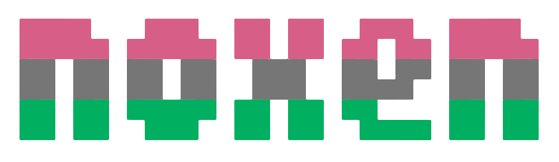
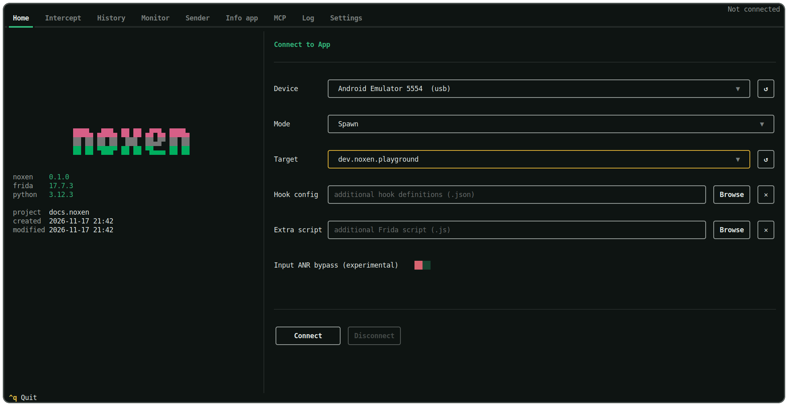
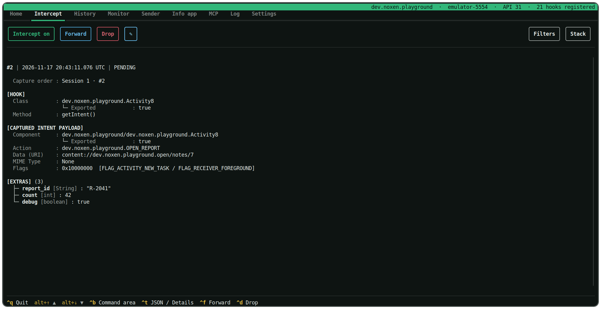
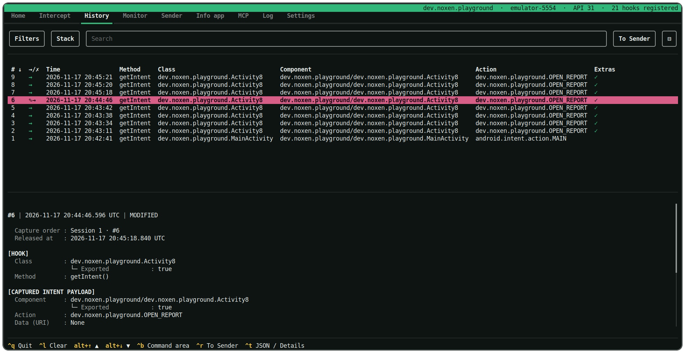

<p align="center">
  
</p>

noxen is a tool for inspecting how the components of an Android app communicate at
runtime. It uses [Frida](https://frida.re) to hook Java methods in the target process,
so you can see each Intent as it is sent or received, change it before the app
continues, or drop it.




## What you can do

- **Hold and edit Intents.** Stop an Intent at a hook, inspect its action, data and
  extras, change any field and let the app continue.
- **Review every capture.** Search all captured Intents, including those that were
  never held.
- **Follow a value.** Record related Java calls, such as SQL queries, file opens and
  WebView loads, without stopping them.
- **Send your own requests.** Start activities, send broadcasts and call content
  providers from an app already running on the device.
- **Inspect the app.** Review its signers, permissions and exported components.
- **Drive noxen from an AI client.** Share the session with an MCP client.

Captures, filters and requests are saved in a `.noxen` project file.

## Installation

You need Python 3.10 or later, a terminal with true color and Unicode support, and an
Android device or emulator running `frida-server`. On Windows, use
[Windows Terminal](https://apps.microsoft.com/detail/9n0dx20hk701).

Install the Frida Python package with the same version as `frida-server` on the
device, then install noxen:

```bash
pip install frida==17.7.3
git clone https://github.com/frankheat/noxen.git
cd noxen
pip install .
```

noxen has been tested with Frida 16.6.6 and 17.7.3. To also install `noxen-analyze`,
which generates hooks from an APK, add the analysis extra:

```bash
pip install ".[analyze]"
```

## Usage

```bash
noxen
```

In **Home**, select the device, a mode and the target app, then choose **Connect**.
noxen opens a new project in the current directory; `noxen --project session.noxen`
reopens one, and `noxen --new-project session` creates a named one.





## Documentation

The full documentation is at **https://frankheat.github.io/noxen-docs/**:

- [Quick start](https://frankheat.github.io/noxen-docs/quick-start/)
- [Commands](https://frankheat.github.io/noxen-docs/commands/) and
  [keyboard shortcuts](https://frankheat.github.io/noxen-docs/keyboard-shortcuts/)
- [Troubleshooting](https://frankheat.github.io/noxen-docs/troubleshooting/)

[noxen playground](https://github.com/frankheat/noxen-playground) is a companion
Android app for controlled tests.

## Development

Install noxen in editable mode with `pip install -e .`. Importable code lives in
`src/noxen/`.

Run the tests with each Frida version you support:

```bash
python -m compileall -q src/noxen
PYTHONPATH=src python -m unittest discover -s tests
```

After changing `agent/script.js` or `agent/system_server.js`, rebuild the Frida bundles
and the packaged runtime copies, and commit them with the source:

```bash
npm install
npm run build
```

## License

noxen is released under the [GNU General Public License v3.0](LICENSE).
